<div align="center">

# 🌱 Verdejar

**Plantas do Brasil, região por região.**

Site colaborativo onde qualquer pessoa descobre as plantas que crescem perto dela — com foto, bioma, clima,
cuidados com luz e água, uso medicinal, toxicidade e curiosidades. Quem cria conta envia novos registros,
que só vão ao ar depois de revisados por um **mediador**.

[](https://github.com/madeiragab/verdejar/actions/workflows/ci.yml)


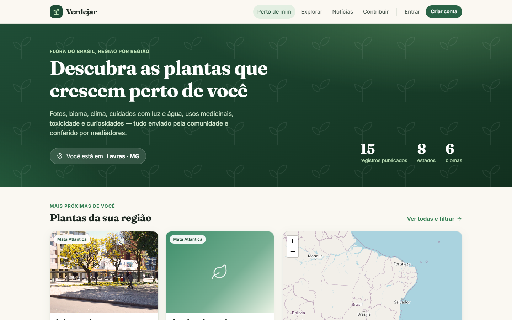

</div>

## Funcionalidades

| | |
|---|---|
| 📍 **Perto de mim** | detecta a localização e já mostra as plantas mais próximas, com mapa |
| 🔎 **Explorar** | filtros por estado, município (lista oficial do IBGE), bioma, luz, água e toxicidade; lista ou mapa |
| 🌿 **Ficha da planta** | foto, nomes, bioma, clima, cuidados, uso medicinal, alerta de toxicidade, curiosidades e fonte |
| 📸 **Contribuir** | foto, ponto no mapa (ou "estou ao lado dela"), dados da espécie e a fonte consultada |
| 🛡️ **Moderação** | fila de revisão, aprovar ou recusar com observação, histórico completo de cada registro |
| 🙋 **Crédito opcional** | o nome do colaborador só aparece se ele autorizar |
| 📰 **Notícias** | clima e meio ambiente de O Eco, ClimaInfo, Agência Brasil, G1 e MetSul (RSS) |
| 👥 **Administração** | promover pessoas a mediadoras |
| 📱 **Responsivo** | pensado para o celular |
| 💸 **Custo zero** | roda inteiro em planos gratuitos (Vercel + Render + Neon + Cloudinary) |

## Telas

Todas as 37 capturas, cobrindo cada fluxo do site, estão em [`img/`](img).

| Perto de mim | Explorar com filtros |
|---|---|
| 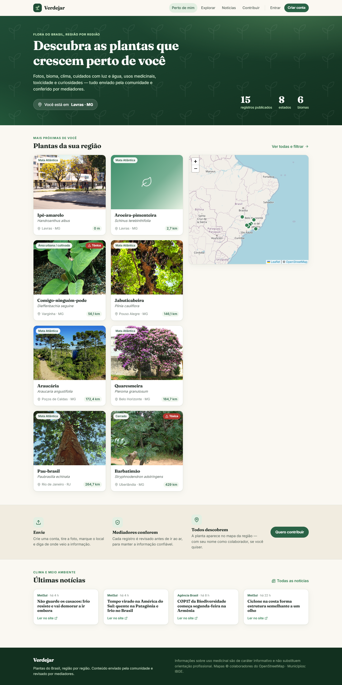 | 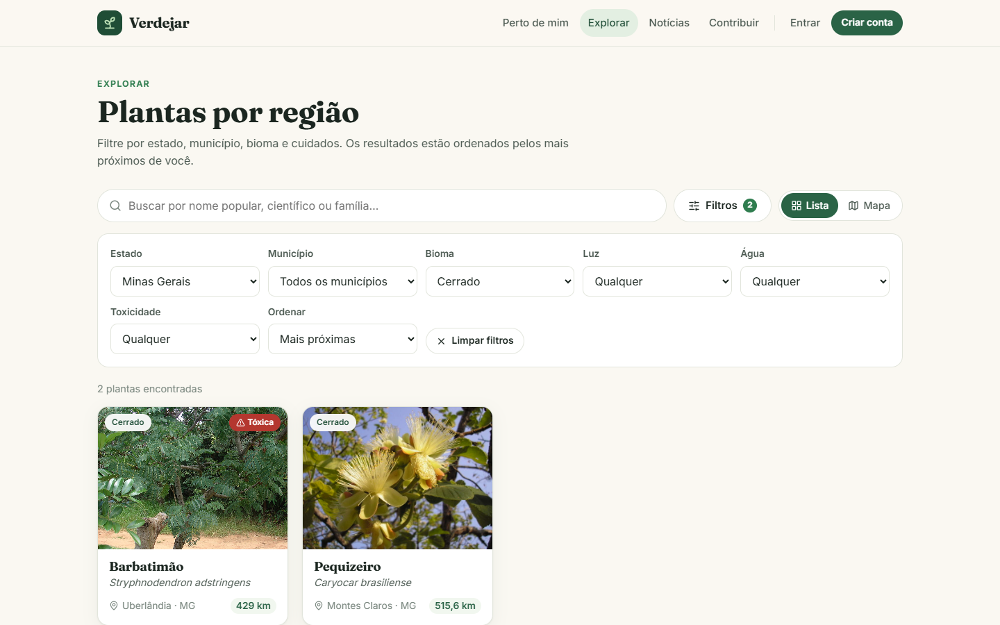 |
| **Mapa** | **Ficha da planta** |
| 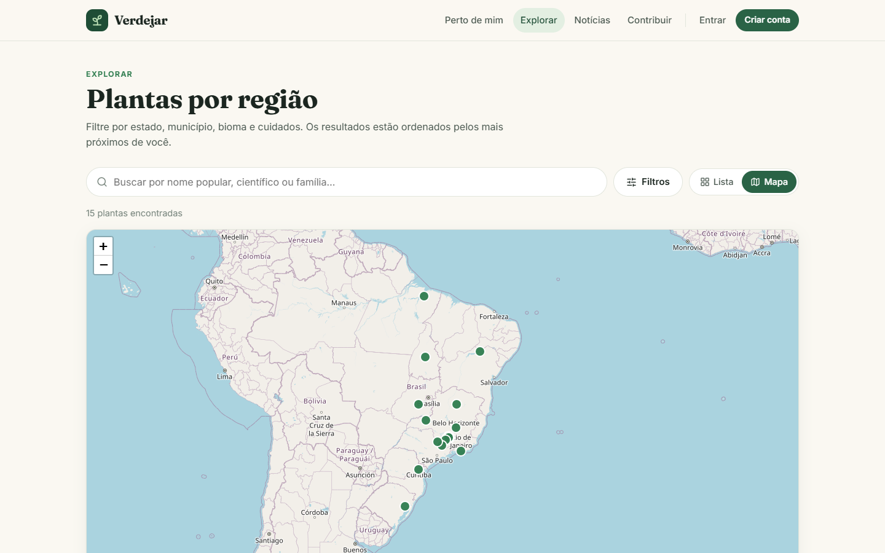 | 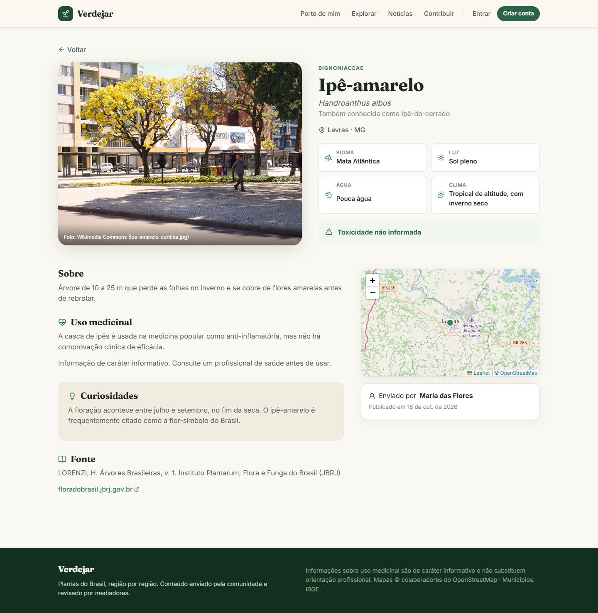 |
| **Alerta de toxicidade** | **Notícias** |
| 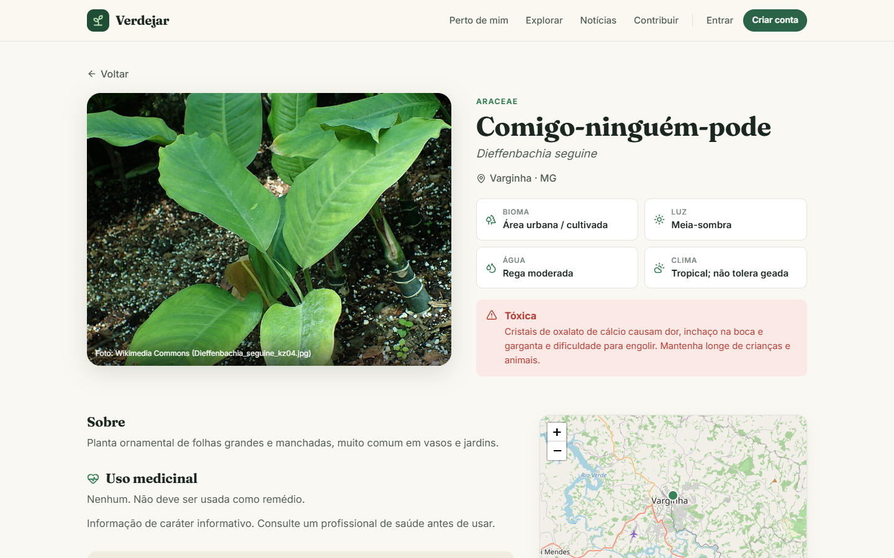 |  |

### Fluxo de contribuição e moderação

| 1. Colaborador preenche | 2. Validação dos campos |
|---|---|
| 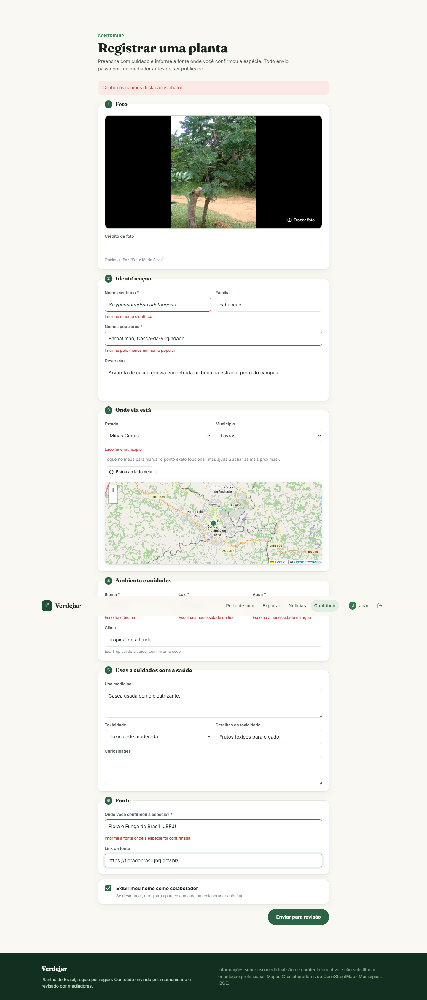 | 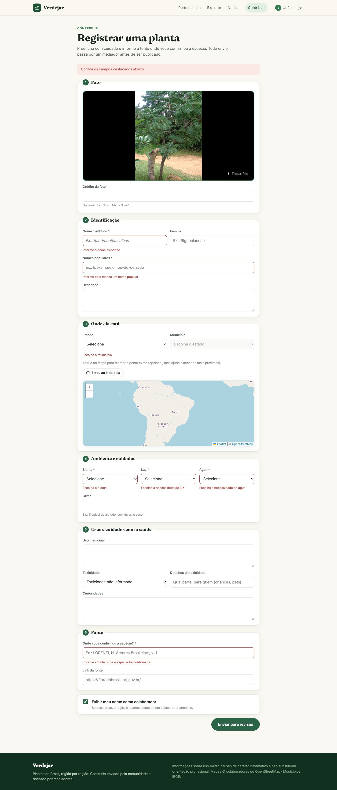 |
| **3. Enviado para revisão** | **4. Mediador revisa** |
| 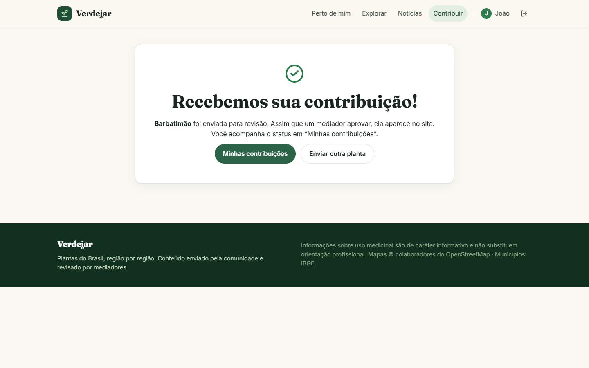 | 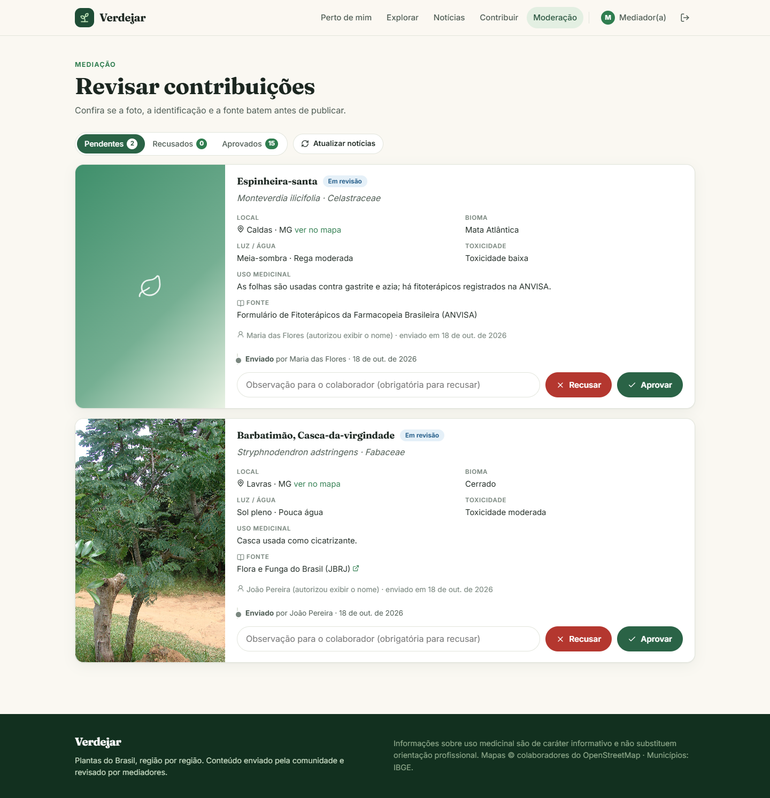 |
| **5. Recusa com observação** | **6. Colaborador vê o que corrigir** |
| 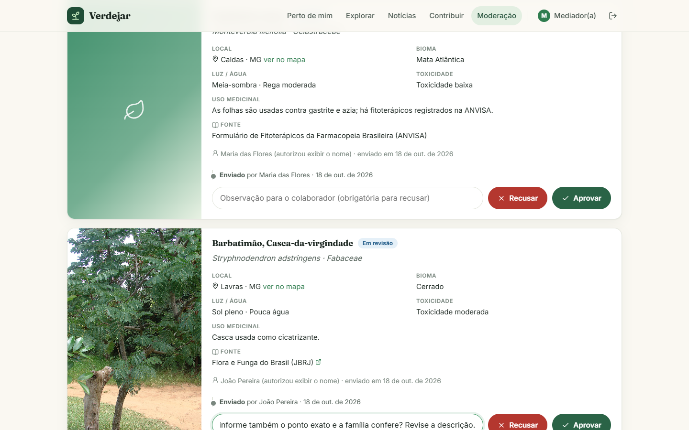 | 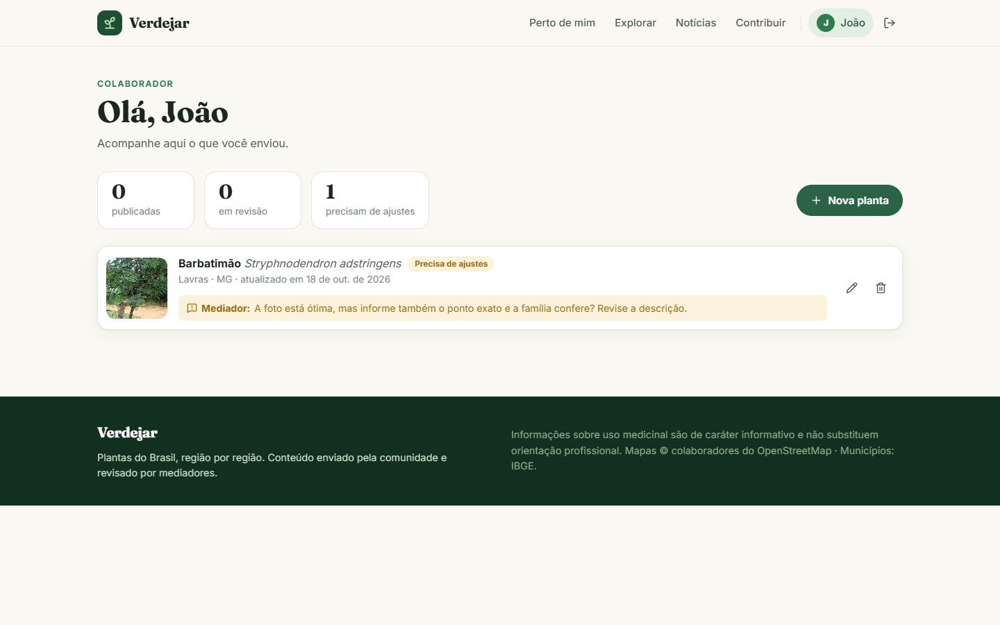 |
| **7. Corrige e reenvia** | **8. Publicado, com crédito autorizado** |
| 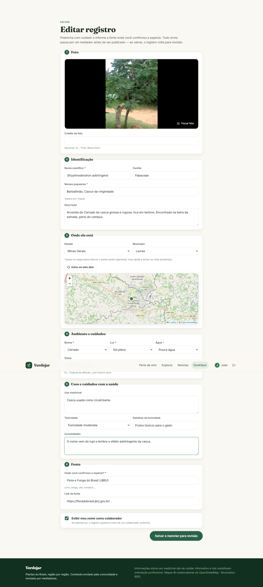 | 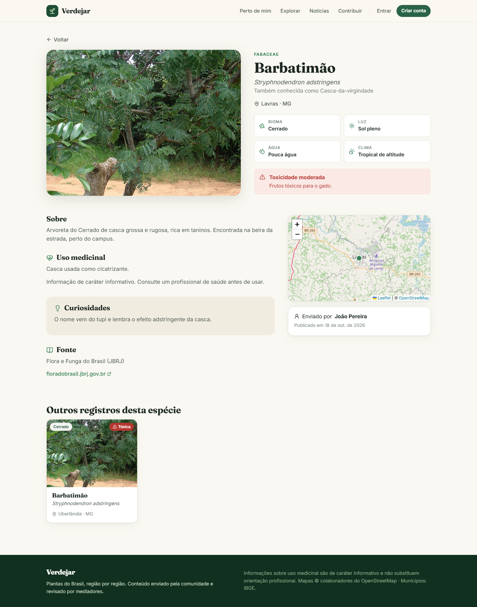 |

### No celular

| Início | Menu | Ficha | Contribuir |
|---|---|---|---|
|  | 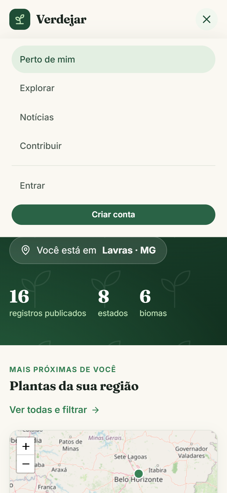 | 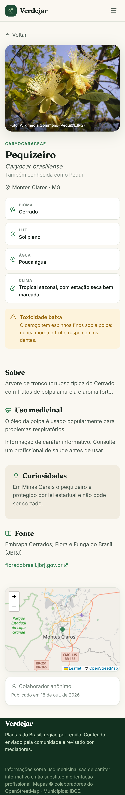 |  |

## Arquitetura

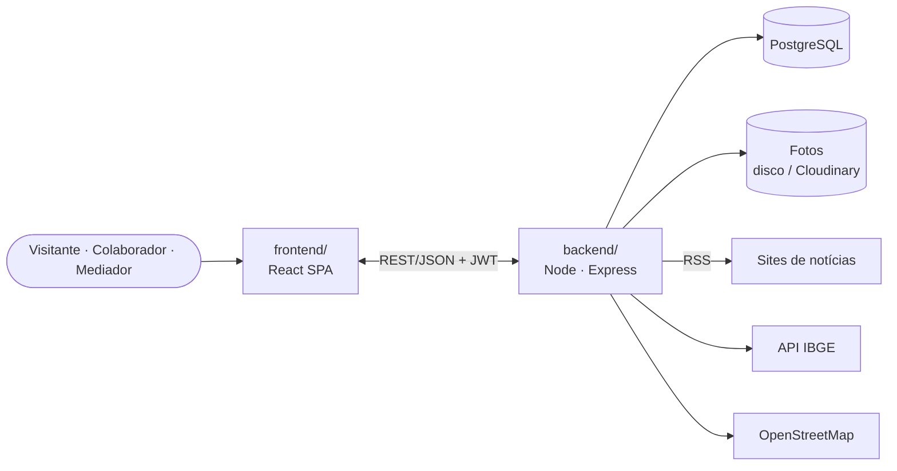

| Pasta | O que é | Stack |
|---|---|---|
| [`backend/`](backend) | API REST | Node.js · TypeScript · Express · Prisma · PostgreSQL · Zod · JWT · Vitest |
| [`frontend/`](frontend) | Site (SPA) | React 18 · TypeScript · Vite · React Router · Leaflet |
| [`docs/`](docs) | Documentação e diagramas | Mermaid |
| [`img/`](img) | Capturas de todas as telas | |

### Documentação

| | |
|---|---|
| [01 · Requisitos](docs/01-requisitos.md) | o que foi pedido, atores, requisitos funcionais e não funcionais |
| [02 · Arquitetura](docs/02-arquitetura.md) | contexto, contêineres, camadas, segurança |
| [03 · Modelo de dados](docs/03-modelo-de-dados.md) | diagrama ER, decisões de modelagem, ciclo de vida |
| [04 · API](docs/04-api.md) | todos os endpoints REST |
| [05 · Fluxos](docs/05-fluxos.md) | sequência do JWT, envio/moderação, localização, notícias |
| [06 · Deploy gratuito](docs/06-deploy-gratuito.md) | passo a passo para colocar no ar sem pagar |

## Rodando localmente

Requisitos: **Node.js 20+**. Não precisa instalar banco nem Docker.

```bash
git clone https://github.com/madeiragab/verdejar.git
cd verdejar
cp backend/.env.example backend/.env
npm run install:all     # dependências da raiz, do backend e do frontend
npm run db              # sobe o PostgreSQL local (deixe rodando)
```

Em outro terminal:

```bash
npm run setup           # cria as tabelas (migrations) e carrega o conteúdo inicial
npm run dev             # API (localhost:3333) + site (localhost:5173)
```

Outros comandos na raiz: `npm test`, `npm run typecheck`, `npm run build`.
Cada pasta também roda sozinha — veja o README do [backend](backend) e do [frontend](frontend).

### Contas de exemplo (só no ambiente local)

| Papel | E-mail | Senha |
|---|---|---|
| Administrador | `admin@verdejar.app` | `verdejar123` |
| Mediador | `mediador@verdejar.app` | `verdejar123` |
| Colaboradora | `maria@exemplo.com` | `verdejar123` |

## Créditos

Fotos do conteúdo inicial: Wikimedia Commons (licenças livres, crédito em cada registro).
Mapas © colaboradores do OpenStreetMap. Estados e municípios: API de Localidades do IBGE.

## Licença

[MIT](LICENSE)
