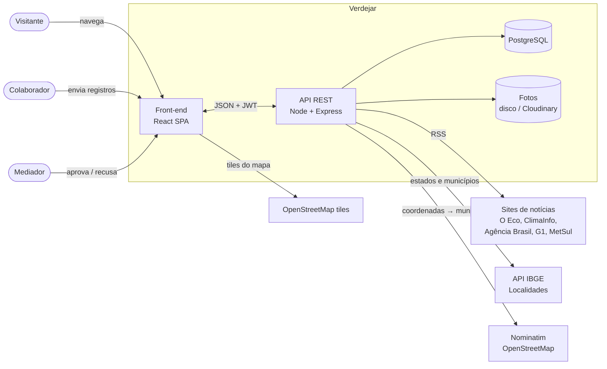
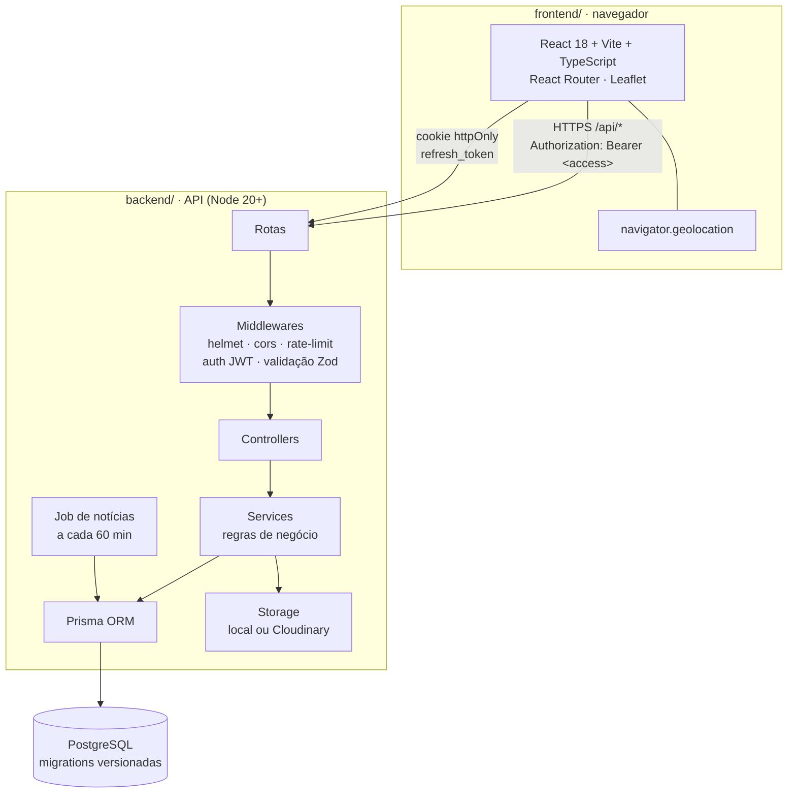

# 02 · Arquitetura

## Visão geral (contexto)



Tudo que está fora da caixa *Verdejar* é **gratuito e público**.

## Contêineres



### Por que essa stack

| Decisão | Motivo |
|---|---|
| **SPA React + API separada** | Pedido explícito (comunicação por API). Permite hospedar o front em CDN gratuita e trocar o front no futuro (ex.: app mobile) sem mexer na API |
| **Node + Express + TypeScript** | Ecossistema enorme, fácil achar quem dê manutenção, roda em qualquer hospedagem gratuita |
| **PostgreSQL + Prisma** | Banco relacional de verdade (enums, chaves estrangeiras, índices) com migrations versionadas no git. No dev sobe sem Docker (`npm run db:start`) |
| **Monorepo com `backend/` e `frontend/` independentes** | Cada um tem seu `package.json`, `.env`, README e deploy. Dá para hospedar separados e até trocar um deles sem mexer no outro |
| **JWT access + refresh** | Access token curto (15 min) vai no header; refresh token (7 dias) fica em cookie `httpOnly` e é guardado com hash no banco → dá para revogar no logout e rotacionar a cada uso |
| **Leaflet + OpenStreetMap** | Mapa sem chave de API e sem cobrança (Google Maps cobra) |
| **IBGE Localidades** | Lista oficial e gratuita de estados e municípios |
| **RSS** | Forma legal e estável de "puxar notícias" de sites específicos sem scraping |

## Organização do código

```
verdejar/
├── docs/                    ← documentação e diagramas (você está aqui)
├── img/                     ← capturas de todas as telas
├── backend/                 ← API REST (Node + Express + Prisma)
│   ├── prisma/
│   │   ├── schema.prisma    ← modelo de dados
│   │   ├── migrations/      ← SQL versionado
│   │   └── seed/            ← dados de referência e conteúdo inicial
│   ├── scripts/dev-db.ts    ← Postgres local sem Docker
│   ├── src/
│   │   ├── server.ts        ← sobe o HTTP e o job de notícias
│   │   ├── app.ts           ← monta o Express (middlewares + rotas)
│   │   ├── config/env.ts    ← lê o .env
│   │   ├── lib/             ← prisma, jwt, erros, storage, geo, texto
│   │   ├── middlewares/     ← auth, validação, upload, erros
│   │   └── modules/
│   │       ├── auth/        ← routes · controller · service · schemas
│   │       ├── plants/      ← routes · controller · service · schemas · mapper
│   │       ├── moderation/
│   │       ├── regions/
│   │       ├── news/
│   │       ├── users/
│   │       └── catalog/
│   └── tests/               ← testes automatizados (Vitest)
├── frontend/                ← site (React + Vite)
│   └── src/
│       ├── api/             ← cliente HTTP com refresh automático + tipos
│       ├── services/        ← uma função por endpoint da API
│       ├── auth/            ← contexto de sessão
│       ├── components/
│       ├── pages/
│       ├── lib/             ← hooks, rótulos, formatação
│       └── styles/
├── .github/workflows/ci.yml ← typecheck, testes, migrations e build a cada push
├── docker-compose.yml       ← Postgres em container (opcional)
└── render.yaml              ← deploy gratuito do backend
```

Cada módulo do backend segue as mesmas camadas:

| Camada | Responsabilidade |
|---|---|
| `*.routes.ts` | URL, método, middlewares (auth, papel, validação) |
| `*.schemas.ts` | Formato da entrada (Zod) e mensagens de erro em português |
| `*.controller.ts` | Traduz HTTP ↔ serviço (status, cookies, corpo) |
| `*.service.ts` | Regras de negócio e acesso ao banco |
| `*.mapper.ts` | Converte linhas do banco no JSON público (esconde dados privados) |

## Segurança

- Senhas com **bcrypt** (custo 10).
- **Zod** valida corpo, query e params de todas as rotas que recebem dados.
- **helmet** (cabeçalhos), **CORS** restrito à origem do front, **rate limit** em `/auth/*`.
- Upload: só `jpeg/png/webp`, máx. 5 MB, nome de arquivo gerado pelo servidor.
- Autorização por papel (`USER` < `MODERATOR` < `ADMIN`) em middleware.
- Conteúdo pendente/recusado **nunca** sai nas rotas públicas.
- Colaborador só vê/edita os próprios registros; nome dele só é exposto com `showContributor = true`.

## Localização ("logo de cara")

1. O front pede `navigator.geolocation` ao abrir a página inicial.
2. Com as coordenadas chama `GET /api/regions/locate?lat&lng` → a API consulta o Nominatim
   (com cache) e devolve `{ state: "MG", municipality: "Lavras" }`.
3. Em seguida `GET /api/plants?lat&lng&sort=distance` traz as aprovadas ordenadas por distância
   (fórmula de Haversine calculada na API).
4. Se a pessoa negar a permissão, a página mostra um seletor de estado e segue normalmente.

Detalhes de cada fluxo em [05-fluxos.md](05-fluxos.md).
