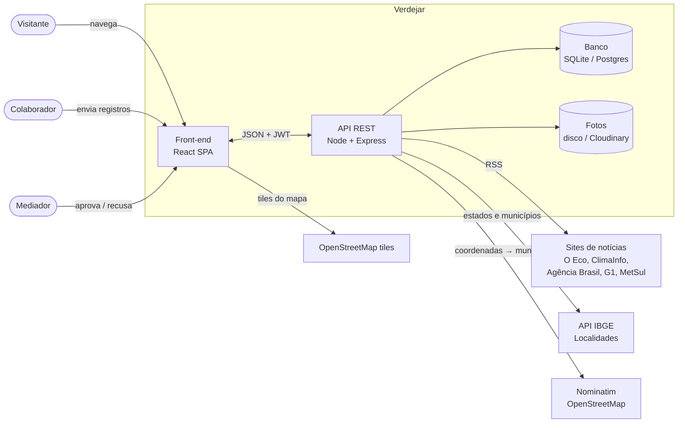
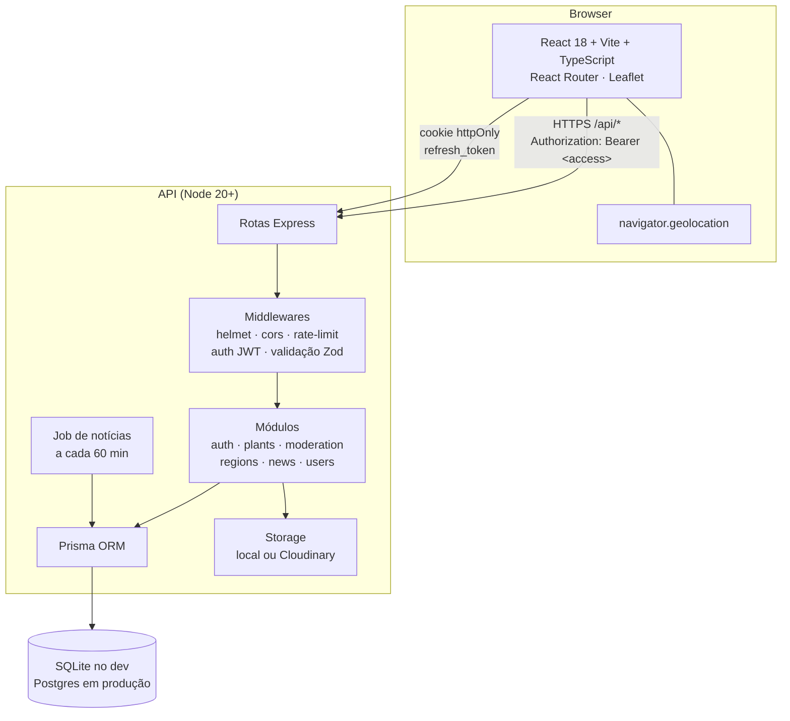

# 02 · Arquitetura

## Visão geral (contexto)



Tudo que está fora da caixa *Verdejar* é **gratuito e público**.

## Contêineres



### Por que essa stack

| Decisão | Motivo |
|---|---|
| **SPA React + API separada** | Pedido explícito (comunicação por API). Permite hospedar o front em CDN gratuita e trocar o front no futuro (ex.: app mobile) sem mexer na API |
| **Node + Express + TypeScript** | Ecossistema enorme, fácil achar quem dê manutenção, roda em qualquer hospedagem gratuita |
| **Prisma** | Mesmo schema roda em SQLite (dev, zero instalação) e Postgres (produção) trocando uma linha |
| **JWT access + refresh** | Access token curto (15 min) vai no header; refresh token (7 dias) fica em cookie `httpOnly` e é guardado com hash no banco → dá para revogar no logout e rotacionar a cada uso |
| **Leaflet + OpenStreetMap** | Mapa sem chave de API e sem cobrança (Google Maps cobra) |
| **IBGE Localidades** | Lista oficial e gratuita de estados e municípios |
| **RSS** | Forma legal e estável de "puxar notícias" de sites específicos sem scraping |

## Organização do código

```
verdejar/
├── docs/                 ← você está aqui
├── api/
│   ├── prisma/
│   │   ├── schema.prisma
│   │   └── seed.ts       ← plantas iniciais + usuários de exemplo
│   └── src/
│       ├── server.ts     ← sobe o HTTP e o job de notícias
│       ├── app.ts        ← monta o Express
│       ├── config.ts     ← lê .env
│       ├── lib/          ← prisma, jwt, erros, storage, geo
│       ├── middlewares/  ← auth, validação, erros
│       └── modules/
│           ├── auth/
│           ├── plants/
│           ├── moderation/
│           ├── regions/
│           ├── news/
│           └── users/
└── web/
    └── src/
        ├── api/          ← cliente HTTP com refresh automático
        ├── auth/         ← contexto de sessão
        ├── components/
        ├── pages/
        └── styles/
```

Cada módulo da API segue o mesmo formato: `*.routes.ts` (HTTP) → `*.service.ts` (regras) → Prisma.

## Segurança

- Senhas com **bcrypt** (custo 10).
- **Zod** valida corpo, query e params de todas as rotas que recebem dados.
- **helmet** (cabeçalhos), **CORS** restrito à origem do front, **rate limit** em `/auth/*`.
- Upload: só `jpeg/png/webp`, máx. 5 MB, nome de arquivo gerado pelo servidor.
- Autorização por papel (`USER` < `MODERATOR` < `ADMIN`) em middleware.
- Conteúdo pendente/recusado **nunca** sai nas rotas públicas.
- Colaborador só vê/edita os próprios registros; nome dele só é exposto com `showContributor = true`.

## Localização ("logo de cara")

1. O front pede `navigator.geolocation` ao abrir a página inicial.
2. Com as coordenadas chama `GET /api/regions/locate?lat&lng` → a API consulta o Nominatim
   (com cache) e devolve `{ state: "MG", municipality: "Lavras" }`.
3. Em seguida `GET /api/plants?lat&lng&sort=distance` traz as aprovadas ordenadas por distância
   (fórmula de Haversine calculada na API).
4. Se a pessoa negar a permissão, a página mostra um seletor de estado e segue normalmente.

Detalhes de cada fluxo em [05-fluxos.md](05-fluxos.md).
