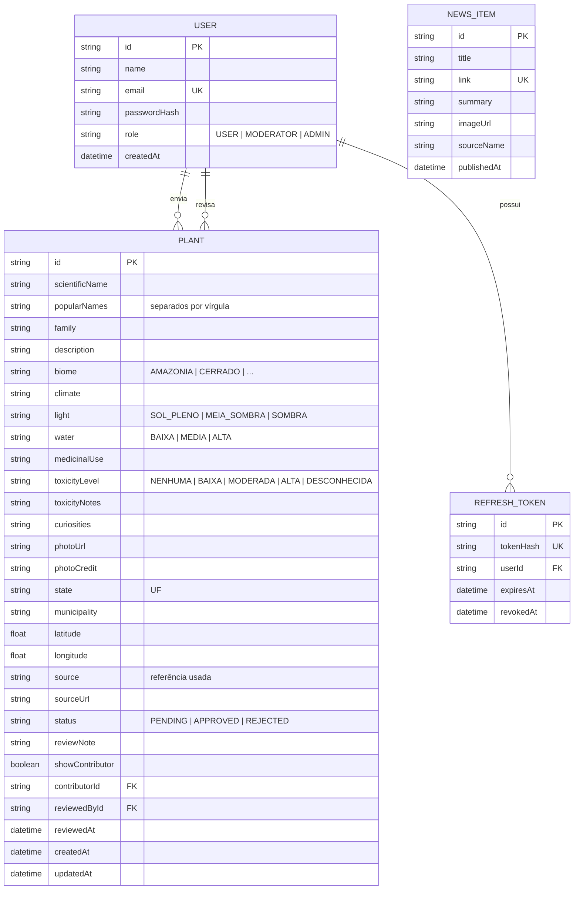
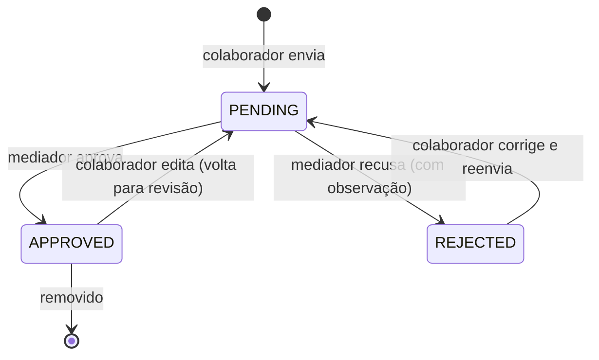

# 03 · Modelo de dados

## Decisões

- **Um registro = uma planta em um lugar.** É exatamente o que o cliente descreveu ("subir a foto,
  colocar os dados da região e a fonte"). A mesma espécie pode aparecer várias vezes, em cidades
  diferentes — isso é desejável para "plantas por região". A página da planta mostra também
  "outros registros desta espécie".
- **Enumerações como texto.** SQLite não tem `enum`; os valores válidos são garantidos pelo Zod
  na API e ficam listados em `api/src/lib/catalog.ts`.
- **Status de moderação no próprio registro.** Fila simples: `PENDING → APPROVED` ou
  `PENDING → REJECTED → (colaborador edita) → PENDING`.
- **Refresh tokens guardados como hash SHA-256** → vazamento do banco não entrega sessões válidas.

## Ciclo de vida de um registro

