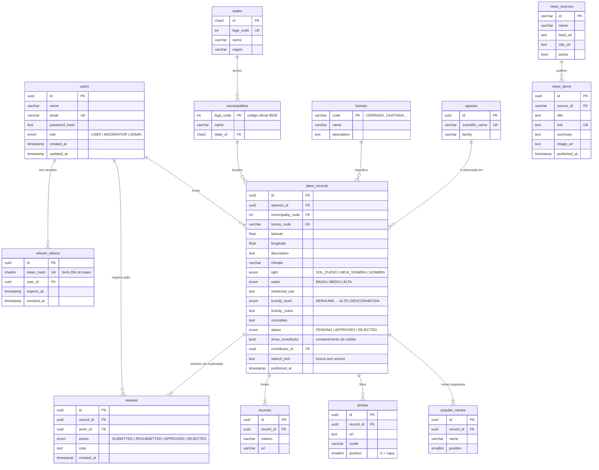
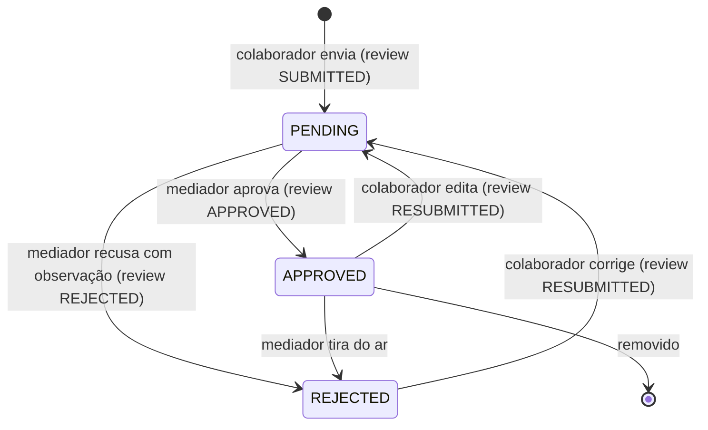

# 03 · Modelo de dados

Banco **PostgreSQL**, modelado com **Prisma** (`backend/prisma/schema.prisma`) e versionado por
**migrations** (`backend/prisma/migrations/`). Tabelas e colunas em `snake_case`; chaves primárias UUID,
exceto tabelas de referência que usam o código oficial (UF, código IBGE, código do bioma).

## Diagrama entidade-relacionamento



## Decisões de modelagem

| Decisão | Por quê |
|---|---|
| **`species` separada de `plant_records`** | A espécie (táxon) é uma só; o que se repete são as observações dela em lugares diferentes. Permite "outros registros desta espécie" e evita duplicar o nome científico. |
| **Registro guarda luz, água, toxicidade etc.** | São afirmações do colaborador naquele envio, revisadas pelo mediador junto com a foto e a fonte. Se ficassem na espécie, um envio novo alteraria dados já aprovados de outras pessoas. |
| **`popular_names`, `photos` e `sources` em tabelas próprias (1:N)** | Uma planta tem vários nomes populares, pode ter várias fotos e várias referências. Nada de listas em texto separadas por vírgula. |
| **`reviews` como histórico** | Em vez de só um campo "observação", cada envio, reenvio, aprovação e recusa vira uma linha — auditoria completa de quem fez o quê e quando. O status atual fica desnormalizado em `plant_records.status` para consultas rápidas. |
| **`states` e `municipalities` com códigos do IBGE** | Chave oficial e estável; nomes iguais em estados diferentes (ex.: "Bom Jesus") não se confundem. Municípios são criados sob demanda, buscando no IBGE no primeiro registro. |
| **`biomes` como tabela** | Permite descrição e futuras traduções sem mudar código. Luz, água, toxicidade e papéis são `enum` do Postgres porque são fixos. |
| **`search_text`** | Texto normalizado (sem acento, minúsculo) com nome científico, nomes populares, família e município. Busca por "ipe" encontra "Ipê" com um `LIKE` simples e indexável. |
| **`news_sources` no banco** | Incluir ou desativar um site de notícias não exige deploy. |
| **Refresh tokens com hash** | Um vazamento do banco não entrega sessões válidas. |
| **Exclusões** | Apagar um registro apaga nomes, fotos, fontes e histórico (`CASCADE`). Apagar um usuário mantém os registros dele, sem autor (`SET NULL`). |

## Ciclo de vida de um registro



## Comandos

```bash
npm run db:start     # sobe o Postgres local (sem Docker)
npm run db:migrate   # cria uma nova migration a partir do schema.prisma
npm run db:deploy    # aplica as migrations (produção)
npm run db:seed      # dados de referência + conteúdo inicial
npm run db:reset     # apaga tudo, reaplica migrations e seed
npm run db:studio    # abre o Prisma Studio para navegar nas tabelas
```
