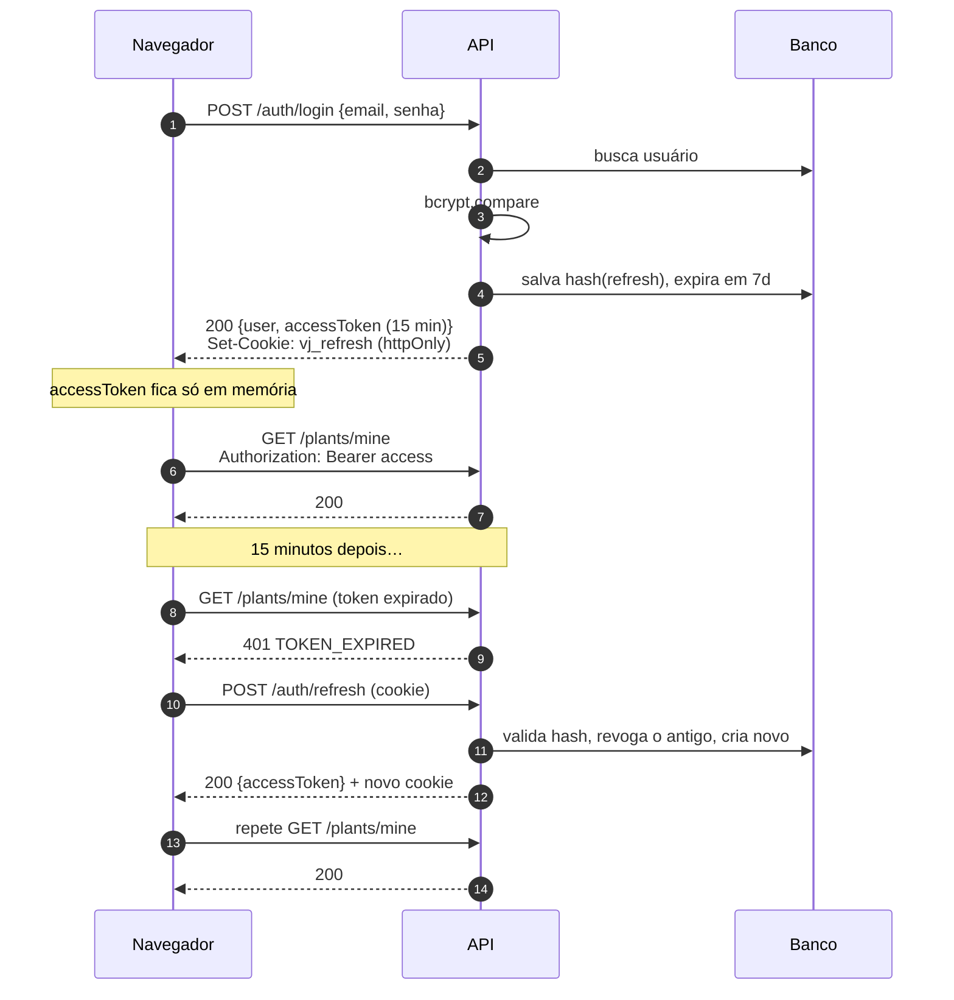
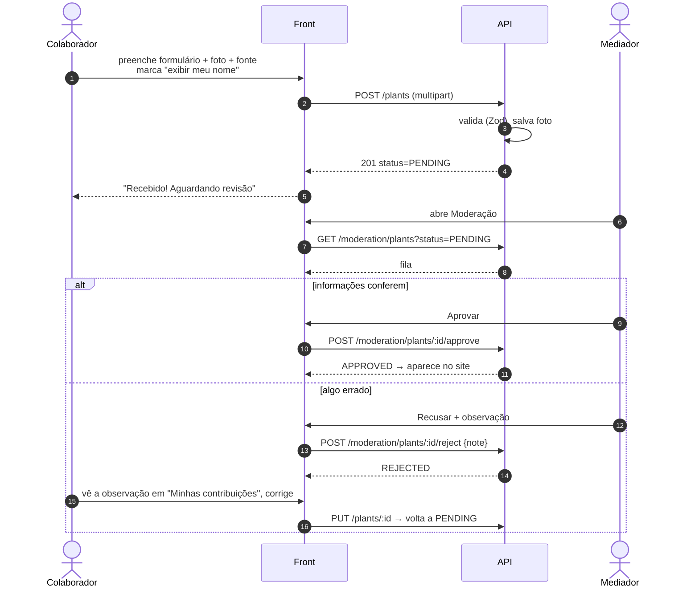
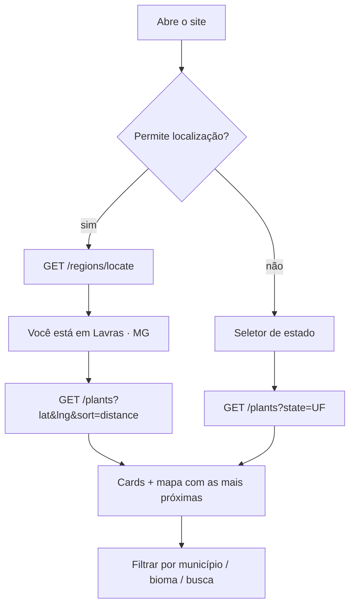
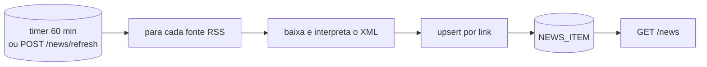

# 05 · Fluxos

## Login e renovação do token (JWT)

Ao recarregar a página o front chama `/auth/refresh` uma vez para recuperar a sessão
(o access token não é salvo em `localStorage`, o que reduz o risco de XSS roubar a sessão).

## Envio e moderação de um registro

## Página inicial com localização

## Coleta de notícias

Fontes iniciais (configuráveis em `api/src/modules/news/sources.ts`):
O Eco, ClimaInfo, Agência Brasil – Meio Ambiente, G1 Natureza e MetSul Meteorologia.
Cada notícia leva o link para o site original (o conteúdo continua sendo deles).
