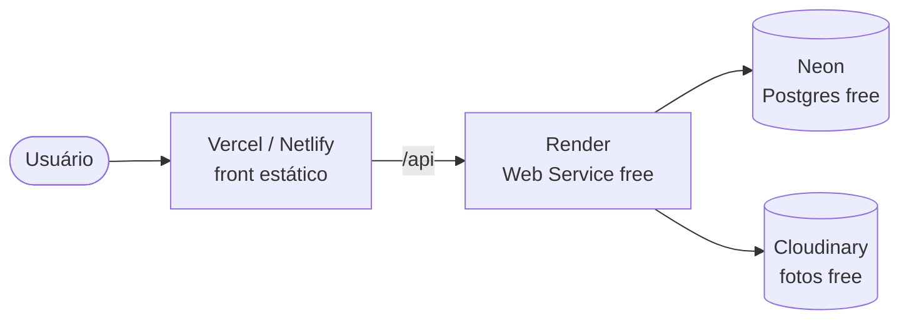

# 06 · Colocando no ar de graça

O cliente não pode pagar, então tudo abaixo usa **planos gratuitos**.

| Peça | Serviço | Limite gratuito (aprox.) | Observação |
|---|---|---|---|
| Front | Vercel ou Netlify | sobra para esse uso | build `npm run build` em `frontend/` |
| API | Render (Web Service) | 750 h/mês | "dorme" após 15 min sem uso; 1º acesso demora ~30 s |
| Banco | Neon Postgres | 0,5 GB | suficiente para dezenas de milhares de registros |
| Fotos | Cloudinary | ~25 GB | o disco do Render é apagado a cada deploy, por isso as fotos vão para fora |

## Passo a passo

1. **Banco (Neon):** criar projeto, copiar a `DATABASE_URL`.
2. **API:** nada a mudar no código — o projeto já usa PostgreSQL.
3. **Render:** *New → Blueprint* usando o `render.yaml` da raiz (ou um *Web Service* apontando para a pasta `backend/`)
   - Build: `npm ci && npx prisma migrate deploy && npm run build`
   - Start: `npm start`
   - Variáveis: `DATABASE_URL`, `JWT_ACCESS_SECRET`, `JWT_REFRESH_SECRET`, `WEB_ORIGIN`
     (URL do front), `COOKIE_SECURE=true`, `CLOUDINARY_URL`, `SEED_ADMIN_EMAIL` e `SEED_ADMIN_PASSWORD`
     (o admin do site em produção).
   - Rodar o seed uma vez (Shell do Render): `npm run db:seed`.
4. **Front (Vercel):** projeto apontando para `frontend/` (o `vercel.json` já trata as rotas da SPA), variável `VITE_API_URL=https://sua-api.onrender.com`.
5. Entrar com o admin e promover quem vai ser mediador em **Usuários**.

> Dica: para evitar a "soneca" do Render, dá para usar um monitor gratuito (UptimeRobot)
> chamando `/api/health` a cada 10 min.

## Domínio

O endereço `*.vercel.app` é gratuito. Domínio `.com.br` próprio custa ~R$ 40/ano no Registro.br —
é o único custo opcional.
