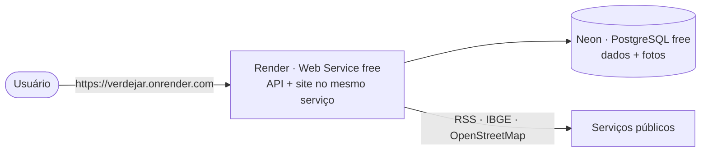

# 06 · Colocando no ar de graça

O cliente não pode pagar, então tudo usa **planos gratuitos** e só duas contas (as duas aceitam
"entrar com GitHub"):

| Peça | Serviço | Limite gratuito (aprox.) | Observação |
|---|---|---|---|
| Site + API | Render (Web Service) | 750 h/mês | "dorme" após 15 min sem acesso; o 1º acesso depois disso leva ~50 s |
| Banco + fotos | Neon (PostgreSQL) | 0,5 GB | as fotos são reduzidas no navegador (~300 KB); cabem milhares de registros |

### Por que um serviço só

- **Login funciona em qualquer navegador.** Com site e API no mesmo domínio o cookie de sessão é "primário";
  com domínios diferentes o Safari (iPhone) bloqueia e a pessoa seria deslogada ao recarregar.
- **Menos contas e menos configuração.** Não precisa de Vercel nem de configurar CORS.
- **Fotos no banco.** O disco do Render é apagado a cada reinício; guardar no Postgres evita uma terceira conta
  (Cloudinary continua suportado via `CLOUDINARY_URL`, se um dia precisar).

## Passo a passo

### 1. Banco no Neon

1. Entre em <https://neon.tech> → **Sign up** → **Continue with GitHub**.
2. Crie um projeto (nome `verdejar`, região **AWS São Paulo** se aparecer, PostgreSQL 17).
3. Na tela do projeto, clique em **Connect**, **desligue "Connection pooling"** e copie a
   connection string (começa com `postgresql://` e termina com `?sslmode=require`).

### 2. Site + API no Render

1. Entre em <https://render.com> → **Get Started** → **GitHub**.
2. **New → Blueprint** → escolha o repositório `verdejar` (autorize o acesso ao repositório se pedir).
3. O Render lê o `render.yaml` e pede três valores:
   - `DATABASE_URL`: a string copiada do Neon
   - `SEED_ADMIN_EMAIL`: e-mail do administrador do site
   - `SEED_ADMIN_PASSWORD`: senha do administrador
4. **Apply**. O primeiro deploy leva ~5 min: instala, cria as tabelas, carrega as plantas iniciais e sobe.
5. O endereço fica em `https://verdejar.onrender.com` (ou parecido, mostrado no topo do serviço).

### 3. Depois de no ar

- Entre com o admin e promova quem vai ser mediador em **Usuários**.
- Cada `git push` na `main` faz um deploy novo automaticamente.

> Dica: para evitar a "soneca" do plano gratuito, dá para usar um monitor gratuito (UptimeRobot)
> chamando `/api/health` a cada 10 min.

## Domínio próprio (opcional)

O endereço `*.onrender.com` é gratuito. Um `.com.br` próprio custa ~R$ 40/ano no Registro.br e se
configura em **Settings → Custom Domains** no Render — é o único custo opcional.

## Alternativa: front e API separados

Também funciona hospedar o `frontend/` na Vercel (o `vercel.json` já trata as rotas) com
`VITE_API_URL` apontando para a API. Nesse caso defina `WEB_ORIGIN` no backend com a URL do site.
